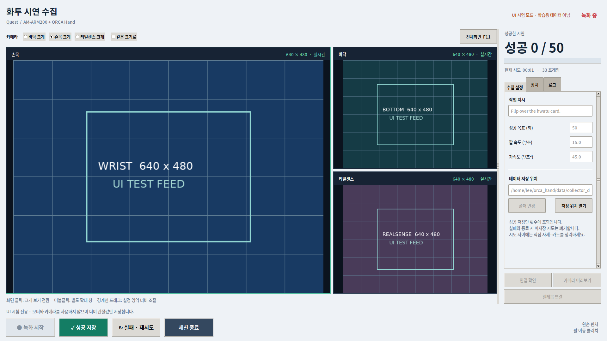

# ORCA Hand Data Collector

**Quest로 AM 팔 + ORCA 손을 텔레오퍼레이션하고, 버튼으로 LeRobot 시연 데이터를 수집하는 Ubuntu 앱입니다.**

현재 구성은 **AM-ARM200 팔 3축 + ORCA Hand v1 오른손 Feetech 17축 = 20-DoF**, 카메라는 **바닥·손목·리얼센스 RGB 3대**입니다. 기본 작업 지시는 **`move the eclipse case`**이며, 데이터는 이후 Hugging Face에 올려 π0.5 학습에 사용할 예정입니다.

이 레포에는 현재 사용 중인 컨트롤러 수정본, 실제 모터 ID 매핑, 손 캘리브레이션, 핀치 보정값과 모델/메시가 포함돼 있습니다. 같은 로봇을 다른 PC로 옮길 때 원본 레포들을 따로 받아 덮어쓰지 마세요.

## 1. 새 Ubuntu PC에 설치

Ubuntu 22.04 / 24.04 x86_64 데스크톱을 대상으로 합니다. 개발·화면 검증은 Ubuntu 22.04에서 진행했습니다. 수집 PC에서 π0.5 학습을 실행할 필요는 없습니다.

터미널에서 아래 순서대로 실행하세요.

```bash
sudo apt-get update
sudo apt-get install -y git curl

git clone https://github.com/saybeok/orca-hand-data-collector.git
cd orca-hand-data-collector

curl -LsSf https://astral.sh/uv/install.sh | sh
export PATH="$HOME/.local/bin:$PATH"

./scripts/install_collector_ubuntu.sh
```

이미 uv가 있으면 uv 설치 두 줄은 생략해도 됩니다. 비공개 레포라면 클론할 수 있는 GitHub 계정 인증이 필요합니다.

설치 스크립트는 Ubuntu GUI/영상 도구와 Python 환경을 설치하고, Quest USB 권한과 `dialout`·`plugdev` 그룹을 설정합니다. 관리자 비밀번호를 요청할 수 있습니다. Python 패키지는 처음 설치할 때 다운로드 용량과 시간이 필요합니다.

**설치가 끝나면 로그아웃 후 다시 로그인하세요.** Quest USB도 다시 연결하세요. 새 그룹 권한은 기존 로그인에 바로 적용되지 않습니다.

## 2. 장치 연결

- 손 USB 어댑터와 팔 USB 어댑터를 각각 연결합니다. 두 어댑터를 서로 바꾸어 지정하면 안 됩니다.
- 바닥 카메라, 손목 카메라, 리얼센스를 연결합니다.
- 개발자 모드가 켜진 Quest를 USB로 연결합니다. 헤드셋에서 **USB 디버깅 허용**을 누릅니다.
- 다른 텔레옵 프로그램과 카메라 미리보기는 종료합니다.

Quest 연결을 확인하려면:

```bash
adb devices -l
```

Quest 행에 `device`가 표시되면 정상입니다. `unauthorized`라면 헤드셋에서 허용하세요. `no permissions` / `insufficient permissions`라면 [권한 오류 해결](#quest-usb-권한-오류)을 참고하세요.

## 3. 수집 앱 실행

앱 메뉴에서 **ORCA 시연 수집**을 열거나 아래 명령을 실행하세요.

```bash
cd ~/orca-hand-data-collector
./scripts/collector_ui.sh
```

다른 경로에 클론했다면 해당 경로에서 실행하면 됩니다. `/home/lee`라는 사용자 이름이나 고정 설치 경로는 필요하지 않습니다.

앱은 최대화로 시작하며, 기본 화면은 **리얼센스 크게 + 바닥·손목 보조 화면**입니다.

- 카메라 화면을 클릭하거나 상단 선택 버튼을 누르면 크게 볼 카메라가 바뀝니다.
- **더블클릭**하면 해당 카메라를 별도 확대 창으로 봅니다. Esc로 확대 창을 닫습니다.
- **F11**은 앱 전체화면, Esc는 전체화면 해제입니다.
- **같은 크기로**를 선택하면 세 영상을 나란히 봅니다. 원본 비율을 유지하며 창 크기에 맞춰 표시됩니다.
- 오른쪽 **수집 설정 / 장치 / 로그** 탭에 설정을 모았습니다. 세로 경계선을 드래그해 영상과 설정 영역의 너비를 조절할 수 있습니다.
- 녹화·성공 저장·실패 재시도·종료 버튼은 하단에 항상 표시됩니다.

1. **연결 확인**을 눌러 장치 상태를 봅니다.
2. 카메라 USB 입력을 지정하고 **카메라 미리보기**로 바닥·손목·리얼센스 화면을 확인합니다.
3. 작업 지시를 확인합니다. 두 손가락으로 집으려면 **중지·약지·새끼 접어 고정**을 체크한 뒤, 로봇을 작업 시작 자세에 놓고 **텔레옵 연결**을 누릅니다. 이 버튼부터 실제 로봇 연결이 시작됩니다.
4. Quest 브라우저에서 **`http://localhost:8765`**를 열고 **Start hand tracking**을 누릅니다.
5. **텔레옵 가능 · 녹화 대기**가 표시되면 물체를 준비하고 **녹화 시작**을 누릅니다. 팔이 저장된 초기 자세로 복귀하고 손 추적·카메라 수신을 확인한 뒤 녹화를 시작합니다.
6. 작업 지시를 수행했으면 **성공 저장**을 누릅니다. 녹화를 멈추고 데이터를 저장한 뒤 팔을 같은 초기 자세로 복귀시킵니다. 실패하면 **실패 · 재시도**로 해당 시도를 버립니다.
7. 자세·물체를 다시 정리하고 다음 **녹화 시작**을 누릅니다. 목표 횟수에 도달하거나 **세션 종료**를 누르면 마무리됩니다.

**왼손 핀치가 팔 이동 클러치**입니다. 왼손 핀치를 풀면 팔이 멈추고 오른손 손가락 조작은 계속됩니다. 녹화 대기 중에도 텔레옵으로 자세를 준비할 수 있지만 그 구간은 데이터에 기록되지 않습니다.

**자동 복귀 후에는 왼손 핀치를 풀었다가 다시 잡아 팔 이동을 시작하세요.** 복귀 전의 VR 목표를 다시 보내지 않으며, 복귀한 팔 위치를 기준으로 추적을 이어갑니다. 초기 자세로 이동하는 구간은 시연 데이터에 포함되지 않습니다.

**중지·약지·새끼 접어 고정**은 기본적으로 꺼져 있습니다. 켜면 세 손가락은 MCP 75°·PIP 90°(각 관절 ROM 안으로 제한)를 유지합니다. 오른손의 좌우 벌림은 중지 8°·약지 0°·새끼 −15°로 고정해, 접힌 중지가 검지 작업 공간을 침범하는 것을 줄입니다. 중지만 약지 쪽으로 밀지 않도록 나머지 두 손가락도 함께 옮긴 자세입니다. 이 값들도 각 관절 ROM 안으로 제한됩니다. 엄지·검지·손목·팔은 계속 조작합니다. 연결 전에 선택하며, 연결 중과 UI 시험 모드에서는 변경할 수 없습니다. 선택은 PC 설정에 저장됩니다. 터미널 수집에서는 `./scripts/record_hwatu.sh --fold-three-fingers`로 같은 옵션을 사용합니다.

### 3구 페달

확인한 PCsensor 3구 페달은 **왼쪽 A → 녹화 시작 / 가운데 B → 성공 저장 / 오른쪽 C → 실패·재시도**입니다. 앱 아래에 페달 연결 상태가 표시됩니다. 녹화 시작은 대기 중에만, 저장·재시도는 녹화 중에만 받습니다. 복귀·저장·변환 중의 입력은 무시하며, 길게 밟거나 자동 반복되어도 다음 시연에서 다시 실행하지 않습니다. 팔 클러치는 기존 왼손 핀치입니다.

앱은 **PCsensor FootSwitch Keyboard 장치만** 받아 일반 키보드의 A/B/C와 구분합니다. 다른 창을 보고 있어도 작동하며, USB를 다시 꽂아 장치 번호가 바뀌면 다시 찾습니다. 같은 이름의 페달이 여러 대면 임의로 고르지 않습니다. 앱을 닫으면 페달 입력을 해제합니다. 앱에 반영하려면 진행 중 시연을 저장하고 세션을 종료한 뒤 **앱 자체를 다시 실행**하세요.

이 입력 방식은 Ubuntu의 **X11/Xorg** 세션과 시스템 `python3-xlib`를 사용합니다. 새 설치 스크립트에 포함되어 있습니다. 기존 설치에서 의존성이 없다면 `sudo apt-get install python3-xlib`로 추가합니다. 페달 접근을 위해 `input` 그룹이나 전체 키보드 장치 권한을 열 필요는 없습니다. 연결되지 않아도 화면의 수집 버튼은 계속 쓸 수 있습니다.

### 팔 준비 자세를 한 번 저장하기

처음에는 저장된 실물 관절각이 없습니다. 연결 전까지 손을 받쳐 두고, **텔레옵 연결** 후 팔에 유지력이 들어오는지 확인하세요. 앱은 손 초기화·카메라 대기보다 먼저 팔을 연결하며, 측정한 현재 자세를 목표로 넣은 뒤 토크를 켭니다.

1. **텔레옵 가능 · 녹화 대기**에서 VR로 팔을 원하는 준비 자세에 놓습니다. 손을 몸체에 가깝게 접으면 앞으로 뻗었을 때보다 무게 부담이 줄어듭니다.
2. 왼손 핀치를 풀어 팔을 멈추고 **수집 설정 → 현재 팔을 초기 자세로 저장**을 누릅니다. 녹화 중에는 저장할 수 없습니다.
3. 다음 **텔레옵 연결**부터 저장한 자세로 천천히 이동합니다. **녹화 시작**, **성공 저장**, **세션 종료** 모두 같은 팔 복귀 자세를 사용합니다. 종료 또는 창 닫기 때는 복귀한 뒤 연결을 정리합니다.

준비 자세 파일은 `data/arm_home/initial_pose.json`이며 이 PC에서 직접 저장합니다. 모터 ID·방향·USB 어댑터가 다른 설정에는 재사용하지 않습니다. 종료 후에도 팔 토크를 유지하므로 프로그램을 닫자마자 팔이 풀리지 않습니다. 전원을 끊으면 유지력이 사라지므로 그전에 팔을 받쳐 놓으세요. 전원이 없는 상태의 처짐이나 모터 유지력 부족까지 소프트웨어로 막을 수는 없습니다.

2026-11-08 실물에서 사람 팔과 좌우 방향이 반대라는 보고에 따라 어깨 좌우 회전(ID 1)의 `shoulder_pan` 방향을 **+1 → −1**로 변경했습니다. 앞뒤·위아래 축 방향은 유지합니다. 기존 설치에 업데이트한 뒤 초기 자세 방향 불일치 오류가 나면, 세션을 종료하고 `orca_teleop/.venv/bin/python scripts/migrate_arm_pan_home.py --apply`를 한 번 실행하세요. 같은 모터 ID·포트·나머지 축 방향인 경우에만 이전 초기 자세를 백업한 뒤 설정에 맞게 좌우 방향 메타데이터를 갱신합니다. 실제 저장된 모터 좌표는 그대로이며 로봇을 연결하거나 움직이지 않습니다. 새 설정은 **세션 종료 후 다시 연결**할 때 적용됩니다.

- 기본 성공 목표: **50회**. 실제 수집 전에는 1회로 저장 결과를 확인하세요.
- 기본 팔 명령 제한: 관절별 **15°/초**, 가속도 **45°/초²**. UI에서 바꿀 수 있습니다. 실제 모터 속도 측정값을 보장하는 제한은 아닙니다.
- 실물 팔 연결 시 **서보에 저장된 각도 범위**를 읽고, 저장된 초기 자세·축 방향을 기준으로 변환해 팔 IK에 반영합니다. 범위 밖 목표를 계속 보내며 계산상 팔 위치만 진행하던 현상을 막습니다. 모터 범위·방향·기존 초기 자세를 자동으로 바꾸지 않습니다. 초기 자세가 어깨 모터의 끝점이면 그 방향으로 더 움직일 수 없으므로, 양방향 여유가 필요할 때는 녹화 대기에서 가동범위 안쪽 자세를 준비하고 **현재 팔을 초기 자세로 저장**을 사용하세요. 새 범위 연결은 세션 종료 후 재연결할 때 적용됩니다.
- 토크가 꺼졌을 때 팔이 처지거나 수동으로 옮겨지면 **현재 위치가 모터 명령 가능 범위 밖**일 수 있습니다. 1° 넘게 벗어난 경우 목표 전송·토크 활성화 전에 연결을 중단하며, 오류에 모터 ID·현재 각도·설정 범위·벗어난 각도를 표시합니다. 팔을 손으로 받쳐 저장한 시작 자세 근처로 옮긴 뒤 재연결하세요. 큰 각도 차이를 허용치 변경이나 끝점으로의 자동 이동으로 건너뛰지 않습니다.
- 팔 IK는 **최신 Quest 손목 입력**으로 계산하고, 손가락 리타겟팅은 별도 작업에서 계산한 최신 결과를 합칩니다. 조종용 입력·명령은 한 칸짜리 대기열을 사용해 밀린 자세를 나중에 재생하지 않습니다. 짧은 왼손 클러치 해제와 재캘리 요청은 입력이 교체돼도 유지합니다. 처음 손 스케일 계산이 끝난 뒤부터 팔 명령을 만들며, 손 계산 결과가 0.5초 이상 오래되면 새 팔 명령을 멈춥니다.
- 녹화용 대기열은 조종용 입력과 별개입니다. **30Hz 영상·관절 기록을 유지**하고, `action`에는 준비 중 후보 명령 대신 전송 처리가 완료된 마지막 20축 명령을 기록합니다. 업데이트 후 세션을 종료하고 **텔레옵 연결**을 다시 누르세요. 세션 로그의 `Arm control | ... input-to-command ...`는 PC 안에서 입력 수신부터 팔 목표 생성까지의 시간이며 Quest 통신·모터 응답까지 포함하는 실물 지연은 아닙니다.
- `--pinch-calibrated`와 수집 앱의 손목 입력 배율은 **2배**입니다(`wrist_input_scale: 2.0`). 오른손 방향 반전 후 실물 손목 ROM인 **−65°~+35°**로 제한합니다. 실물 팔+손 경로에서는 예전 시뮬레이션 손목 범위가 다시 잘라내지 않도록 했으며, 시뮬레이션 자체의 관절 범위는 유지합니다.
- 엄지–검지 핀치는 자동 스케일이 적용된 랜드마크 간격 **3 cm 이하에서 닫힘 목표**, **6 cm 이상에서 일반 추적**으로 연속 전환합니다. 검지 쌍의 접촉 가중치는 8입니다(기존 1). 이는 모터 힘 배율이 아니라 최적화에서 접촉 목표에 주는 비중입니다. 기존 10 mm 닫힘 보정값을 사용하며, 실물 접촉·집는 힘을 보장하는 센서 피드백은 없습니다. 설정 변경은 세션 종료 후 다시 연결할 때 적용됩니다.
- 수집용 보정 프로필은 `scale_calibration: bone_lengths`를 사용합니다. 첫 30프레임에서 각 손가락의 인접 관절 사이 길이를 합해 손 크기를 추정합니다. 손을 접었을 때 손바닥–손끝 직선거리가 짧아져 배율이 과도하게 커지던 문제를 피합니다. 이 설정이 없는 기존 프로필은 이전 계산을 유지합니다.
- 엄지 끝마디(ID 15)는 손끝이 가까워져도 굽힘 추종 항을 유지합니다(`thumb_ip_bend_scope: always`, `w_thumb_ip_bend: 50`). 기존에는 핀치가 활성화될 때 이 항이 사라져, 사람이 굽혀도 로봇 엄지가 펴질 수 있었습니다. 멀리서는 직접 추종하고, 가까이서는 접촉 목표와 굽힘 목표를 함께 최적화합니다. 관절 범위·속도 제한은 유지합니다.
- 현재 수집 프로필은 엄지 끝마디의 **자유 동작**에 `thumb_ip_free_bend_gain: 2.0`을 적용합니다. 해당 세션에서 입력 굽힘 최대 약 53°가 ID 15의 약 45° 명령에 그쳐, 단독 90° 테스트보다 움직임이 작았던 점을 반영한 조작 범위 조정입니다. 자유 동작에서는 모델 기준각 약 7.71°를 뺀 양의 관절 이동량만 2배로 매핑해 입력 53°가 약 90.6°의 관절 목표가 됩니다. 핀치가 활성화되면 이 배율은 연속적으로 1배로 돌아가므로, 완전히 닫힌 핀치는 기존 굽힘 목표와 접촉 계산을 유지합니다. 핀치에도 2배를 적용한 합성 시험에서는 손끝 간격이 벌어져 자유 동작으로 범위를 한정했습니다. 펴진 쪽의 명령과 관절 영점·원시 랜드마크·모터 캘리는 바꾸지 않습니다. 이것은 사람의 실제 각도를 측정해 교정한 값이 아니므로 실물에서 추종·접촉을 확인하세요. `thumb_ip_free_bend_gain: 1.0`이면 기존 범위로 돌아가며, 항목이 없는 다른 프로필도 기본값 1.0을 사용합니다. 로그는 원시 입력·보정된 목표·모델 결과·모터 환산각을 따로 남깁니다. 세션 종료 후 다시 연결하면 적용됩니다.
- 실물 수집기는 기본적으로 초당 한 번 `Hand finger feedback`을 기록합니다. 엄지·검지 등의 `cmd_deg`와 `encoder_joint_deg` 차이로 명령 추종을 확인합니다. 엔코더 환산각은 실제 링크각·접촉력의 독립 측정값은 아닙니다. 필요하면 CLI의 `--no-hand-feedback-debug`로 끌 수 있습니다.
- 실물 팔+손 경로의 손가락·손목 범위는 손 설정의 `joint_roms`를 기준으로 통일합니다. 모델 벡터에는 각 관절의 `ref`를 더해 변환합니다. 예전에는 ID 16(`thumb_pip`, 엄지 가운데 굽힘)의 108° 목표가 모델 범위 때문에 약 104°로 잘렸습니다. 이제 실물 경로에서는 해당 목표를 그대로 전달하며, 시뮬레이션의 모델 범위와 팔 범위는 그대로 사용합니다. ID 15(`thumb_dip`, 끝마디)와는 다른 문제입니다.
- **세 손가락 접어 고정**은 이제 리타겟터를 초기화할 때 같은 9개 관절각을 IK 내부에도 고정합니다. 고정 손가락의 자세 추종 항과 중지·약지·새끼 핀치 목표는 비활성화하고 엄지–검지 작업을 풉니다. 후단 고정 처리·녹화 벡터와 같은 자세를 사용합니다. 현재 지원 백엔드는 `adaptive_analytical`입니다. 고정 모드 없이 실행할 때는 기존 다섯 손가락 목표를 유지합니다.
- 수집 앱의 `Hand command trace`는 약 초당 한 번 같은 `command_timestamp_ns`에 대한 `ik_deg`, 제한·고정 후 `final_deg`, 실제 쓰기에 사용한 `applied_deg`, 신선한 `encoder_joint_deg`를 묶습니다. 표면 모드에서는 **최종 명령**으로 다시 계산한 `final_model_clearance_mm`, `target_clearance_mm`, `final_residual_mm`도 포함합니다. 엔코더 환산각은 독립적인 링크 각도 센서가 아니며 실제 패드 접촉을 보장하지 않습니다. 최적화 예외는 이전 자세를 유지하며 실패 횟수·종료 상태·손실을 경고 로그에 남깁니다. UI 하단에는 실행 중인 리타겟터와 프로필 파일명이 표시됩니다.
- 표면 핀치의 접촉 모델은 기존 방식 그대로입니다. 완전 핀치에서는 피부 볼록 껍질 간 거리를 사용하며, 지정 패드 위치·법선의 정렬까지 검증한 방식은 아닙니다. 수동 접촉 24개로 얻은 거리 보정만으로 이 정렬이나 부하 중 텐던 전달 특성이 식별되지는 않습니다. 이번 실행 경로 수정이 실물 접촉 오차까지 해결했다는 의미는 아닙니다.
- GUI의 **녹화 시작**은 팔 복귀 완료 후 녹화를 시작하고, **성공 저장**은 녹화 종료·데이터 저장 후 팔을 복귀시킵니다. **실패 재시도**도 현재 시도를 폐기한 뒤 같은 저장된 팔 초기 자세로 복귀하고 다음 녹화를 기다립니다. 오른쪽 페달도 같은 동작을 사용합니다. 실패 시도와 복귀 동작은 학습 데이터에 저장하지 않습니다. 손가락은 별도 중립 자세로 바꾸지 않습니다. 이미 같은 목표를 유지하며 도착한 상태면 불필요한 복귀 대기 시간을 반복하지 않습니다. 복귀 실패 시에는 새 녹화를 시작하지 않고 오류를 표시합니다.
- **세션 종료 / 창 닫기**는 미저장 시도를 폐기하고, 이미 성공 저장한 에피소드는 유지합니다. 정리가 끝나기 전에 PC 전원이나 USB를 끊지 마세요.
- 카메라가 일부만 연결돼도 미리보기는 가능합니다. 실제 텔레옵 연결 전에는 세 카메라와 두 로봇 어댑터가 모두 확인돼야 합니다.
- 기본 저장은 **수집과 LeRobot 변환을 분리**합니다. 녹화 중에는 **별도 저장 프로세스**가 JPEG 품질 95의 프레임과 관절·명령을 보관하고 H.264 인코딩·영상 통계는 계산하지 않습니다. 텔레옵과 같은 Python 인터프리터에서 JPEG 작업까지 실행하며 대기열이 밀리던 문제를 줄였습니다. 프로세스 사이에는 버퍼 크기가 제한된 로컬 소켓을 사용하며, 성공 저장은 해당 시연의 모든 프레임 저장과 디스크 동기화 응답을 받은 뒤 확정합니다. 저장 프로세스 실패를 감지하면 현재 시도는 실패 처리하고 이전 성공 시연은 보존합니다. 해상도 640×480·30Hz·20축 관절 벡터는 유지합니다. JPEG와 최종 H.264는 손실 압축입니다.
- 성공 횟수는 수집 프레임·관절 데이터를 디스크에 동기화하고 에피소드 폴더를 확정한 뒤 올라갑니다. 아직 LeRobot 변환 완료를 뜻하지 않습니다. 실패·재시도는 해당 미저장 시도만 삭제합니다. 기존 동시 인코딩은 CLI `--video-storage streaming`, PNG/AV1은 `--video-storage images`로 선택할 수 있습니다. 새 기본값은 앱 재시작 후 다시 연결할 때 적용됩니다.

아래는 **합성 카메라 영상과 더미 데이터로 UI 동작을 검증한 화면**입니다. 실제 시연 영상은 아닙니다.



## 4. 새 PC에서 카메라 지정

USB 포트 구조는 PC마다 달라집니다. 예전 PC의 `usb=1-1.4` 같은 값을 그대로 쓸 수 있다고 가정하지 마세요.

앱의 바닥·손목·리얼센스 USB 선택 칸에서 현재 입력을 골라 미리보기로 확인하세요. **연결 확인**은 사용 가능한 입력 목록도 갱신합니다. 설정은 이 PC의 `data/collector_ui/settings.json`에 저장됩니다.

- 리얼센스는 고유 시리얼로 선택할 수 있어 USB 포트 변경에 영향을 덜 받습니다.
- 두 HD 카메라는 **서로 같은 시리얼을 보고**하므로 USB 포트로 구분합니다. 각 역할을 확인한 뒤 같은 물리 포트에 연결해 두세요.
- `video0`, `video3` 같은 번호는 재연결할 때 바뀔 수 있습니다.
- 같은 물리 입력을 두 역할에 중복 지정하면 녹화를 시작하지 않습니다.

## 수집 후 LeRobot 일괄 변환

1. 성공 시연을 모은 뒤 **세션 종료**가 끝날 때까지 기다립니다.
2. **LeRobot 일괄 변환**을 누르고 세션 폴더 또는 여러 세션이 든 상위 폴더를 선택합니다. 앱을 재시작한 뒤에도 가능합니다.
3. 세션·에피소드·프레임 진행 상태를 확인합니다. 변환 중에는 텔레옵을 연결하지 않습니다.
4. 각 세션의 **`lerobot/`** 폴더가 Hugging Face 업로드·학습에 쓰는 결과입니다. **저장 위치 열기**로 마지막 결과를 확인합니다.

변환기는 수집본 체크섬을 확인하고, 세 영상과 관절의 프레임 수·해상도·FPS·타임스탬프를 검증합니다. 완성된 결과만 공개하며 실패해도 수집본은 유지합니다. 같은 폴더를 다시 선택해 재시도할 수 있고, 이미 같은 원본으로 완료한 세션은 건너뜁니다. 수집본과 변환 결과가 모두 보관되므로 디스크 공간은 두 자료의 합계만큼 필요합니다. 이전 방식으로 만든 LeRobot 데이터셋은 이 버튼의 변환 대상이 아닙니다.

터미널에서도 로봇·카메라 연결 없이 실행할 수 있습니다:

```bash
cd /path/to/orca-hand-data-collector
source env.sh
orca_teleop/.venv/bin/python orca_teleop/scripts/convert_recordings.py \
  --source data/lerobot
```

## 5. 저장되는 데이터

기본 저장 폴더는 이 레포 아래 **`data/lerobot/hwatu_날짜_시간_식별자/`**입니다. UI에서 폴더를 바꾸거나 **저장 위치 열기**를 눌러 확인할 수 있습니다. 각 세션은 새 폴더에 저장하며 기존 데이터를 덮어쓰지 않습니다. 녹화 직후에는 `capture.json`과 `episode-*/` 수집본이 있고, 변환 후에는 그 안에 `lerobot/` 데이터셋이 생깁니다.

- `observation.images.bottom`, `.wrist`, `.realsense`: RGB 영상 3개, 각 640×480. 깊이 영상은 현재 저장하지 않습니다.
- `observation.state`: 팔 3축 + 손 17축 현재 상태, 총 20개. 손 상태는 모터 엔코더에서 환산한 추정값입니다.
- `action`: IK·리타겟팅과 명령 제한을 거친 목표 관절값 20개. 세 손가락 고정 옵션을 켜면 고정 처리가 반영된 최종 명령이 저장됩니다. 벡터 크기는 계속 20개입니다. 고정 자세를 바꿔도 실제 적용된 값은 세션의 `fixed_finger_pose_deg`에 기록되므로 이전 수집본과 구분할 수 있습니다.
- `task`: 기본값은 `move the eclipse case`라는 작업 지시입니다. 기존에 저장된 데이터셋의 작업 지시는 변경하지 않습니다.
- LeRobot이 관리하는 프레임·에피소드·시간 정보. 수집 주기는 30Hz를 목표로 합니다.

관절 벡터는 모델의 공통 라디안 규칙을 사용합니다. 순서는 데이터셋 메타데이터에 기록됩니다. 원본 Quest 손 좌표나 촉각·접촉력은 현재 기록하지 않습니다.

`collection_session.json`과 `collection_*` 파일에는 세션의 관절 순서, 설정, 손 캘리브레이션, 모델/설정 해시와 **연결 시 팔 모터 기준값**도 보관합니다. 세 손가락 고정 여부는 `arguments.fold_three_fingers`, 물리 각도 목표는 `fixed_finger_pose_deg`에 보관합니다.

**팔 원점은 현재 연결 순간 자세를 기준으로 합니다.** 세션 기준값을 보관하는 기능이 전역 기계 원점을 고정해 주는 것은 아닙니다. 여러 세션을 π0.5 학습에 합치거나 실물 추론에 쓰기 전에는 좌표 기준을 통일하고, 입력·출력 변환과 정규화 설정을 준비해야 합니다. 이 레포에 완성된 π0.5 학습/배포 파이프라인이 포함된 것은 아닙니다.

수집 데이터, UI 설정·로그, 테스트용 더미 데이터는 Git에 업로드되지 않습니다. Hugging Face 데이터 업로드와 RunPod 학습은 별도 단계입니다.

## 로봇 없이 UI 시험

```bash
./scripts/collector_ui.sh --demo
```

모터와 카메라를 열지 않고 녹화·폐기·저장 버튼 흐름을 시험합니다. `data/collector_demo/`에 **17축 더미 관절값**을 저장하며 실제 20-DoF 시연과 구분됩니다. 학습용 데이터에 섞지 마세요.

## 문제 해결

### Quest에서 ERR_EMPTY_RESPONSE가 표시될 때

앱에서 **텔레옵 가능 · 녹화 대기**가 표시된 뒤 Quest Browser의 `http://localhost:8765`를 여세요. USB/ADB 전달이 정상이어도 PC 수집 프로세스가 로봇·카메라 연결 단계에서 종료되면 WebXR 서버는 시작되지 않습니다. 앱의 오류와 세션 `recorder.log`에서 실제 원인을 확인하세요.

`Arm did not reach initial pose`가 원인이면 메시지에 각 관절 오차와 허용값이 표시됩니다. 이 조립체의 부하가 걸린 팔꿈치에서 약 3.7°의 정지 오차를 확인해 `home_tolerance_deg: 5`로 설정했습니다. 이 값은 초기/복귀 도착 판정에만 적용하며, 저장된 목표 자세·모터 명령·세션 좌표 원점은 바꾸지 않습니다. 5°를 넘는 오차와 통신 실패는 계속 오류로 처리합니다. 다른 로봇에서 오차가 크면 값을 계속 늘리는 대신 실제 목표·측정값과 기구 상태를 확인하세요.

### Quest USB 권한 오류

현재 Quest 3 USB ID `2833:5013`용 규칙이 포함돼 있습니다.

```bash
cd ~/orca-hand-data-collector
sudo install -m 0644 configs/udev/70-orca-quest.rules /etc/udev/rules.d/70-orca-quest.rules
sudo udevadm control --reload-rules
sudo udevadm trigger --action=add --subsystem-match=usb --attr-match=idVendor=2833 --attr-match=idProduct=5013
adb kill-server
adb start-server
adb devices -l
```

필요하면 Quest USB만 뺐다가 다시 꽂고 헤드셋에서 USB 디버깅을 허용하세요. `adb`나 수집 앱 전체를 `sudo`로 실행하지 마세요.

### 손 또는 팔 USB 어댑터를 찾지 못함

```bash
ls -l /dev/serial/by-id/
```

현재 로봇 어댑터 시리얼은 손 `5B79079884`, 팔 `5B79018828`이며 설정은 아래 파일에 있습니다.

- 손: `configs/orcahand-right-v1-feetech/config.yaml`
- 팔: `configs/am-arm200-3dof/config.yaml`

같은 어댑터를 옮겼다면 시리얼은 그대로지만, 새 어댑터로 교체했다면 `port`를 실제 경로로 바꿔야 합니다. 기존 캘리브레이션·ID 매핑은 **현재 로봇 한 대에 맞춘 값**이며 다른 손에 그대로 적용하는 범용 설정이 아닙니다.

### 카메라가 열리지 않음 / 영상이 안 나옴

다른 카메라 앱·텔레옵을 닫고 USB 입력을 다시 선택하세요. 리얼센스의 깊이/IR/메타데이터 입력 대신 RGB 입력이 선택돼야 합니다. 현재 HD 카메라는 MJPG로 요청해 USB 대역폭을 줄입니다. 초점이 흐리면 확대 표시로 해결되지 않으므로 촬영 거리·렌즈 상태도 확인하세요.

### 세션이 시작되지 않음

앱 하단 로그를 확인하세요. 전체 로그는 `data/collector_ui/sessions/<세션>/recorder.log`에 있습니다. Quest 브라우저가 열린 것만으로는 충분하지 않고 **Start hand tracking**을 누르고 오른손이 추적돼야 합니다.

### VR 시작 순간 팔이 처짐

팔을 받침으로 지지한 상태에서 확인하세요. 준비 자세 저장만으로 전원·유지력 문제를 해결할 수는 없습니다. 팔 설정의 `feedback_diagnostics: true`는 기존 연결에서 1초에 한 번 STS 상태를 읽고 `Arm feedback` 로그를 남깁니다. 별도 USB 연결을 열거나 목표각·토크·보호 설정을 바꾸지 않습니다.

로그에는 요청한 각도, 모터에 실제 설정된 목표각, 실제각, 토크 켜짐, 실제 토크 한도(48번 레지스터), 전압, 전류, 온도, 보호 상태가 들어갑니다. VR 시작 전후를 비교해 명령 변화·전압 저하·보호 작동·추종 오차를 구분합니다. `max_torque` 설정값만 보고 실제 모터 출력이나 유지력을 판단하지 마세요. 상태 비트 의미는 [Feetech STS 공식 메모리 표](https://ftservo.github.io/ftservo-wiki/reference/parameter/memory-sts/)를 참고하세요.

### 설치 후 환경 확인

```bash
source env.sh
orca_teleop/.venv/bin/python -c 'import mujoco, pinocchio, lerobot; print("recording dependencies OK")'
./scripts/collector_ui.sh --demo
```

## 개발·구성

```text
scripts/collector_ui.sh                 수집 앱 실행
scripts/install_collector_ubuntu.sh     새 Ubuntu PC 설치
orca_teleop/src/orca_teleop/collector_app.py      데스크톱 UI
orca_teleop/src/orca_teleop/collection_control.py 로컬 녹화 제어·미리보기
orca_teleop/scripts/record_dataset.py    LeRobot 기록
configs/                               이 로봇의 모터·카메라·리타겟 설정
data/contact_calibration/               확인된 접촉 기록·핀치 보정 프로필
orca_core/                             수정된 하드웨어 제어 코드
orca_am200/robot_model/                 팔+손 20-DoF 모델
orcahand_description/                   ORCA 모델·메시
```

기존 상세 셋업 기록은 [legacy-setup.md](docs/legacy-setup.md), 원본 프로젝트 출처는 [THIRD_PARTY.md](THIRD_PARTY.md)를 참고하세요.

로봇 없이 실행하는 관련 테스트:

```bash
source env.sh
uv sync --project orca_teleop --python 3.11 --extra learning --extra test
uv pip install --python orca_teleop/.venv/bin/python 'mujoco==3.6.0'
orca_teleop/.venv/bin/python -m pytest \
  orca_teleop/tests/test_collection_control.py \
  orca_teleop/tests/test_recording_ready.py \
  orca_teleop/tests/test_cameras.py \
  orca_teleop/tests/test_preview_cameras.py \
  orca_teleop/tests/test_pipeline.py -q
```

기존 PC에서 관련 테스트 93개와 더미 데이터 저장·폐기 UI 흐름을 확인했습니다. 전용 PC에서의 실제 20-DoF 텔레옵·카메라 3대 동시 수집은 장치 연결 후 확인해야 합니다.

저장 성능 확인(2026-11-06): 실제 녹화 RGB 3개를 640×480·30Hz로 60초 재생하고 합성 움직임 리타겟팅·미리보기 계산을 병행한 시험에서 1,800프레임, 대기열 최대 4/64, 수집본 저장 확정 약 0.08초를 확인했습니다. 실제 장치 전체를 조작하는 세션과 동일한 조건의 성능 보장은 아닙니다. 별도 프로세스 저장·변환·오류 복구·팔 복귀·수집 제어 테스트 85개와 더미 UI 흐름도 통과했습니다. 수정은 기존 세션을 종료하고 다시 연결할 때 적용됩니다.
