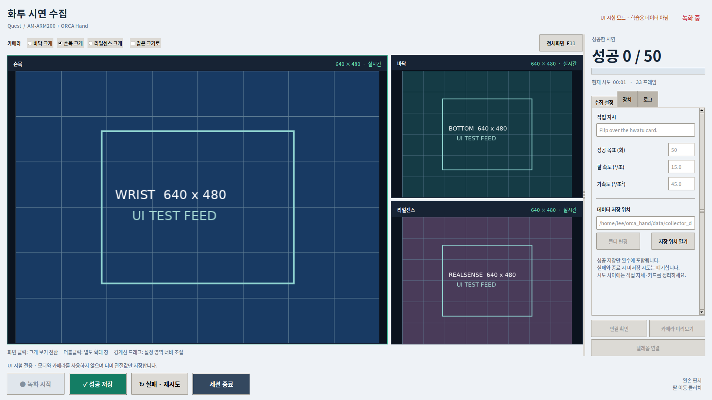

# ORCA Hand Data Collector

**Quest로 AM 팔 + ORCA 손을 텔레오퍼레이션하고, 버튼으로 LeRobot 시연 데이터를 수집하는 Ubuntu 앱입니다.**

현재 구성은 **AM-ARM200 팔 3축 + ORCA Hand v1 오른손 Feetech 17축 = 20-DoF**, 카메라는 **바닥·손목·리얼센스 RGB 3대**입니다. 작업은 화투 카드 옮기기이며, 데이터는 이후 Hugging Face에 올려 π0.5 학습에 사용할 예정입니다.

이 레포에는 현재 사용 중인 컨트롤러 수정본, 실제 모터 ID 매핑, 손 캘리브레이션, 핀치 보정값과 모델/메시가 포함돼 있습니다. 같은 로봇을 다른 PC로 옮길 때 원본 레포들을 따로 받아 덮어쓰지 마세요.

## 1. 새 Ubuntu PC에 설치

Ubuntu 22.04 / 24.04 x86_64 데스크톱을 대상으로 합니다. 개발·화면 검증은 Ubuntu 22.04에서 진행했습니다. 수집 PC에서 π0.5 학습을 실행할 필요는 없습니다.

터미널에서 아래 순서대로 실행하세요.

```bash
sudo apt-get update
sudo apt-get install -y git curl

git clone https://github.com/saybeok/orca-hand-data-collector.git
cd orca-hand-data-collector

curl -LsSf https://astral.sh/uv/install.sh | sh
export PATH="$HOME/.local/bin:$PATH"

./scripts/install_collector_ubuntu.sh
```

이미 uv가 있으면 uv 설치 두 줄은 생략해도 됩니다. 비공개 레포라면 클론할 수 있는 GitHub 계정 인증이 필요합니다.

설치 스크립트는 Ubuntu GUI/영상 도구와 Python 환경을 설치하고, Quest USB 권한과 `dialout`·`plugdev` 그룹을 설정합니다. 관리자 비밀번호를 요청할 수 있습니다. Python 패키지는 처음 설치할 때 다운로드 용량과 시간이 필요합니다.

**설치가 끝나면 로그아웃 후 다시 로그인하세요.** Quest USB도 다시 연결하세요. 새 그룹 권한은 기존 로그인에 바로 적용되지 않습니다.

## 2. 장치 연결

- 손 USB 어댑터와 팔 USB 어댑터를 각각 연결합니다. 두 어댑터를 서로 바꾸어 지정하면 안 됩니다.
- 바닥 카메라, 손목 카메라, 리얼센스를 연결합니다.
- 개발자 모드가 켜진 Quest를 USB로 연결합니다. 헤드셋에서 **USB 디버깅 허용**을 누릅니다.
- 다른 텔레옵 프로그램과 카메라 미리보기는 종료합니다.

Quest 연결을 확인하려면:

```bash
adb devices -l
```

Quest 행에 `device`가 표시되면 정상입니다. `unauthorized`라면 헤드셋에서 허용하세요. `no permissions` / `insufficient permissions`라면 [권한 오류 해결](#quest-usb-권한-오류)을 참고하세요.

## 3. 수집 앱 실행

앱 메뉴에서 **ORCA 시연 수집**을 열거나 아래 명령을 실행하세요.

```bash
cd ~/orca-hand-data-collector
./scripts/collector_ui.sh
```

다른 경로에 클론했다면 해당 경로에서 실행하면 됩니다. `/home/lee`라는 사용자 이름이나 고정 설치 경로는 필요하지 않습니다.

앱은 최대화로 시작하며, 기본 화면은 **손목 카메라 크게 + 바닥·리얼센스 보조 화면**입니다.

- 카메라 화면을 클릭하거나 상단 선택 버튼을 누르면 크게 볼 카메라가 바뀝니다.
- **더블클릭**하면 해당 카메라를 별도 확대 창으로 봅니다. Esc로 확대 창을 닫습니다.
- **F11**은 앱 전체화면, Esc는 전체화면 해제입니다.
- **같은 크기로**를 선택하면 세 영상을 나란히 봅니다. 원본 비율을 유지하며 창 크기에 맞춰 표시됩니다.
- 오른쪽 **수집 설정 / 장치 / 로그** 탭에 설정을 모았습니다. 세로 경계선을 드래그해 영상과 설정 영역의 너비를 조절할 수 있습니다.
- 녹화·성공 저장·실패 재시도·종료 버튼은 하단에 항상 표시됩니다.

1. **연결 확인**을 눌러 장치 상태를 봅니다.
2. 카메라 USB 입력을 지정하고 **카메라 미리보기**로 바닥·손목·리얼센스 화면을 확인합니다.
3. 로봇을 작업 시작 자세에 놓고 **텔레옵 연결**을 누릅니다. 이 버튼부터 실제 로봇 연결이 시작됩니다.
4. Quest 브라우저에서 **`http://localhost:8765`**를 열고 **Start hand tracking**을 누릅니다.
5. **텔레옵 가능 · 녹화 대기**가 표시되면 자세·카드를 준비하고 **녹화 시작**을 누릅니다.
6. 카드 뒤집기에 성공하면 **성공 저장**을 누릅니다. 실패하면 **실패 · 재시도**로 해당 시도를 버립니다.
7. 자세·카드를 다시 정리하고 다음 **녹화 시작**을 누릅니다. 목표 횟수에 도달하거나 **세션 종료**를 누르면 마무리됩니다.

**왼손 핀치가 팔 이동 클러치**입니다. 왼손 핀치를 풀면 팔이 멈추고 오른손 손가락 조작은 계속됩니다. 녹화 대기 중에도 텔레옵으로 자세를 준비할 수 있지만 그 구간은 데이터에 기록되지 않습니다.

- 기본 성공 목표: **50회**. 실제 수집 전에는 1회로 저장 결과를 확인하세요.
- 기본 팔 명령 제한: 관절별 **15°/초**, 가속도 **45°/초²**. UI에서 바꿀 수 있습니다. 실제 모터 속도 측정값을 보장하는 제한은 아닙니다.
- GUI에서는 시도 사이에 **자동 홈 이동을 하지 않습니다**. 직접 재정리한 다음 녹화를 시작합니다.
- **세션 종료 / 창 닫기**는 미저장 시도를 폐기하고, 이미 성공 저장한 에피소드는 유지합니다. 정리가 끝나기 전에 PC 전원이나 USB를 끊지 마세요.
- 카메라가 일부만 연결돼도 미리보기는 가능합니다. 실제 텔레옵 연결 전에는 세 카메라와 두 로봇 어댑터가 모두 확인돼야 합니다.

아래는 **합성 카메라 영상과 더미 데이터로 UI 동작을 검증한 화면**입니다. 실제 시연 영상은 아닙니다.



## 4. 새 PC에서 카메라 지정

USB 포트 구조는 PC마다 달라집니다. 예전 PC의 `usb=1-1.4` 같은 값을 그대로 쓸 수 있다고 가정하지 마세요.

앱의 바닥·손목·리얼센스 USB 선택 칸에서 현재 입력을 골라 미리보기로 확인하세요. **연결 확인**은 사용 가능한 입력 목록도 갱신합니다. 설정은 이 PC의 `data/collector_ui/settings.json`에 저장됩니다.

- 리얼센스는 고유 시리얼로 선택할 수 있어 USB 포트 변경에 영향을 덜 받습니다.
- 두 HD 카메라는 **서로 같은 시리얼을 보고**하므로 USB 포트로 구분합니다. 각 역할을 확인한 뒤 같은 물리 포트에 연결해 두세요.
- `video0`, `video3` 같은 번호는 재연결할 때 바뀔 수 있습니다.
- 같은 물리 입력을 두 역할에 중복 지정하면 녹화를 시작하지 않습니다.

## 5. 저장되는 데이터

기본 저장 폴더는 이 레포 아래 **`data/lerobot/hwatu_날짜_시간_식별자/`**입니다. UI에서 폴더를 바꾸거나 **저장 위치 열기**를 눌러 확인할 수 있습니다. 각 세션은 새 폴더에 저장하며 기존 데이터를 덮어쓰지 않습니다.

- `observation.images.bottom`, `.wrist`, `.realsense`: RGB 영상 3개, 각 640×480. 깊이 영상은 현재 저장하지 않습니다.
- `observation.state`: 팔 3축 + 손 17축 현재 상태, 총 20개. 손 상태는 모터 엔코더에서 환산한 추정값입니다.
- `action`: IK·리타겟팅과 명령 제한을 거친 목표 관절값 20개.
- `task`: 기본값은 `move the hwatu card.`라는 작업 지시입니다.
- LeRobot이 관리하는 프레임·에피소드·시간 정보. 수집 주기는 30Hz를 목표로 합니다.

관절 벡터는 모델의 공통 라디안 규칙을 사용합니다. 순서는 데이터셋 메타데이터에 기록됩니다. 원본 Quest 손 좌표나 촉각·접촉력은 현재 기록하지 않습니다.

`collection_session.json`과 `collection_*` 파일에는 세션의 관절 순서, 설정, 손 캘리브레이션, 모델/설정 해시와 **연결 시 팔 모터 기준값**도 보관합니다.

**팔 원점은 현재 연결 순간 자세를 기준으로 합니다.** 세션 기준값을 보관하는 기능이 전역 기계 원점을 고정해 주는 것은 아닙니다. 여러 세션을 π0.5 학습에 합치거나 실물 추론에 쓰기 전에는 좌표 기준을 통일하고, 입력·출력 변환과 정규화 설정을 준비해야 합니다. 이 레포에 완성된 π0.5 학습/배포 파이프라인이 포함된 것은 아닙니다.

수집 데이터, UI 설정·로그, 테스트용 더미 데이터는 Git에 업로드되지 않습니다. Hugging Face 데이터 업로드와 RunPod 학습은 별도 단계입니다.

## 로봇 없이 UI 시험

```bash
./scripts/collector_ui.sh --demo
```

모터와 카메라를 열지 않고 녹화·폐기·저장 버튼 흐름을 시험합니다. `data/collector_demo/`에 **17축 더미 관절값**을 저장하며 실제 20-DoF 시연과 구분됩니다. 학습용 데이터에 섞지 마세요.

## 문제 해결

### Quest USB 권한 오류

현재 Quest 3 USB ID `2833:5013`용 규칙이 포함돼 있습니다.

```bash
cd ~/orca-hand-data-collector
sudo install -m 0644 configs/udev/70-orca-quest.rules /etc/udev/rules.d/70-orca-quest.rules
sudo udevadm control --reload-rules
sudo udevadm trigger --action=add --subsystem-match=usb --attr-match=idVendor=2833 --attr-match=idProduct=5013
adb kill-server
adb start-server
adb devices -l
```

필요하면 Quest USB만 뺐다가 다시 꽂고 헤드셋에서 USB 디버깅을 허용하세요. `adb`나 수집 앱 전체를 `sudo`로 실행하지 마세요.

### 손 또는 팔 USB 어댑터를 찾지 못함

```bash
ls -l /dev/serial/by-id/
```

현재 로봇 어댑터 시리얼은 손 `5B79079884`, 팔 `5B79018828`이며 설정은 아래 파일에 있습니다.

- 손: `configs/orcahand-right-v1-feetech/config.yaml`
- 팔: `configs/am-arm200-3dof/config.yaml`

같은 어댑터를 옮겼다면 시리얼은 그대로지만, 새 어댑터로 교체했다면 `port`를 실제 경로로 바꿔야 합니다. 기존 캘리브레이션·ID 매핑은 **현재 로봇 한 대에 맞춘 값**이며 다른 손에 그대로 적용하는 범용 설정이 아닙니다.

### 카메라가 열리지 않음 / 영상이 안 나옴

다른 카메라 앱·텔레옵을 닫고 USB 입력을 다시 선택하세요. 리얼센스의 깊이/IR/메타데이터 입력 대신 RGB 입력이 선택돼야 합니다. 현재 HD 카메라는 MJPG로 요청해 USB 대역폭을 줄입니다. 초점이 흐리면 확대 표시로 해결되지 않으므로 촬영 거리·렌즈 상태도 확인하세요.

### 세션이 시작되지 않음

앱 하단 로그를 확인하세요. 전체 로그는 `data/collector_ui/sessions/<세션>/recorder.log`에 있습니다. Quest 브라우저가 열린 것만으로는 충분하지 않고 **Start hand tracking**을 누르고 오른손이 추적돼야 합니다.

### 설치 후 환경 확인

```bash
source env.sh
orca_teleop/.venv/bin/python -c 'import mujoco, pinocchio, lerobot; print("recording dependencies OK")'
./scripts/collector_ui.sh --demo
```

## 개발·구성

```text
scripts/collector_ui.sh                 수집 앱 실행
scripts/install_collector_ubuntu.sh     새 Ubuntu PC 설치
orca_teleop/src/orca_teleop/collector_app.py      데스크톱 UI
orca_teleop/src/orca_teleop/collection_control.py 로컬 녹화 제어·미리보기
orca_teleop/scripts/record_dataset.py    LeRobot 기록
configs/                               이 로봇의 모터·카메라·리타겟 설정
data/contact_calibration/               확인된 접촉 기록·핀치 보정 프로필
orca_core/                             수정된 하드웨어 제어 코드
orca_am200/robot_model/                 팔+손 20-DoF 모델
orcahand_description/                   ORCA 모델·메시
```

기존 상세 셋업 기록은 [legacy-setup.md](docs/legacy-setup.md), 원본 프로젝트 출처는 [THIRD_PARTY.md](THIRD_PARTY.md)를 참고하세요.

로봇 없이 실행하는 관련 테스트:

```bash
source env.sh
uv sync --project orca_teleop --python 3.11 --extra learning --extra test
uv pip install --python orca_teleop/.venv/bin/python 'mujoco==3.6.0'
orca_teleop/.venv/bin/python -m pytest \
  orca_teleop/tests/test_collection_control.py \
  orca_teleop/tests/test_recording_ready.py \
  orca_teleop/tests/test_cameras.py \
  orca_teleop/tests/test_preview_cameras.py \
  orca_teleop/tests/test_pipeline.py -q
```

기존 PC에서 관련 테스트 93개와 더미 데이터 저장·폐기 UI 흐름을 확인했습니다. 전용 PC에서의 실제 20-DoF 텔레옵·카메라 3대 동시 수집은 장치 연결 후 확인해야 합니다.
